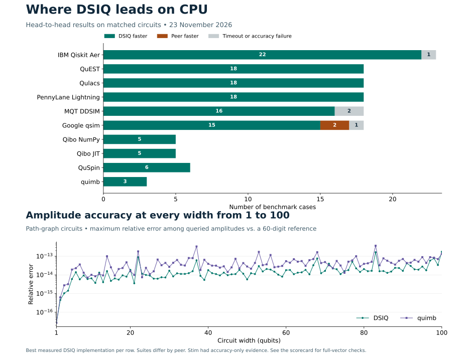

# DSIQ State Vector Engine compared with other simulators

23 November 2026 · Project-run, single-thread CPU benchmarks

On 23 selected MQT Bench and QASMBench circuits, both the standalone native DSIQ executable and the JavaScript implementation passed every accuracy check. Native was fastest on 17 cases, JavaScript on four, and qsim on two. The two DSIQ implementations were invoked separately. The combined 21/23 count uses the faster measured DSIQ implementation on each circuit. Production automatic selection has not been benchmarked here.

## Head-to-head CPU results

Each score is **DSIQ faster / peer faster** among cases where both passed. A timeout or missed accuracy threshold is shown separately. The figures are medians of three adapter timings. Row totals vary because each peer was matched to the workload tested with it. The same circuit appears against several peers.

| Peer | Workload | Native DSIQ vs peer | JavaScript DSIQ vs peer | Best measured DSIQ vs peer | Other outcomes |
|---|---|---:|---:|---:|---|
| IBM Qiskit Aer | MQT + QASMBench | 22 / 0 | 16 / 6 | 22 / 0 | 1 Aer timeout |
| QuEST | MQT | 18 / 0 | 10 / 8 | 18 / 0 | — |
| Qulacs | MQT | 17 / 1 | 8 / 10 | 18 / 0 | — |
| PennyLane Lightning | MQT | 17 / 1 | 14 / 4 | 18 / 0 | — |
| MQT DDSIM | MQT | 16 / 0 | 14 / 2 | 16 / 0 | 2 DDSIM timeouts |
| Google qsim | MQT | 13 / 4 | 8 / 9 | 15 / 2 | 1 qsim accuracy failure |
| Qibo NumPy | QASMBench | 5 / 0 | 5 / 0 | 5 / 0 | — |
| Qibo JIT | QASMBench | 5 / 0 | 5 / 0 | 5 / 0 | — |
| QuSpin | Two-excitation sector | — | — | 6 / 0 | DSIQ sector engine, 50–100 qubits |
| quimb | Path-graph circuits | — | — | 3 / 0 | DSIQ matrix-product-state engine, 50, 75 and 100 qubits |
| Stim | Clifford observables | — | — | Untimed | Agreement on all 1,100 comparisons at 100 qubits |

Single-precision qsim led on 20-qubit second-seed QAOA (68.38 vs 89.08 ms) and entangled-input QFT (118.86 vs 131.32 ms). Maximum absolute probe errors were respectively 1.09e-8 and 4.21e-8 for qsim and 3.71e-18 and 1.73e-16 for the fastest DSIQ implementation on each. At 20-qubit Grover, native DSIQ took 15.98 ms and DDSIM took 857.66 ms. Full circuit-by-circuit tables include precision settings, timeouts and scoring rules. [Detailed scorecard](competitive-cpu-2026-11-23.md)

## What was verified from 1 to 100 qubits?

| Coverage | Verification | Result |
|---|---|---|
| Every width 1–20 | Full complex state of 256 seeded circuits vs independent NumPy evolution | 4,341,720 amplitudes compared; maximum absolute difference 3.11e-15 |
| One connected 25-qubit circuit | Full complex state vs Aer | All 33,554,432 coefficients checked; maximum absolute difference 3.28e-17 |
| Every width 1–100 | Selected complex amplitudes and norm on a path circuit per width vs a 60-digit reference | Both DSIQ and quimb passed all 100 widths |
| Every width 3–100 | Direct two-excitation sector | All 98 widths passed; all 4,950 sector coefficients checked at width 100 |
| One 100-qubit Clifford circuit | 10,000 gates, 1,100 observable comparisons vs Stim | Zero discrepancy; global phase unmeasured |

Across the 100-width path sweep, DSIQ's worst absolute amplitude error was 5.21e-16, worst relative amplitude error was 1.75e-13 and worst norm error was 2.71e-14. For quimb the corresponding values were 1.19e-15, 3.66e-13 and 4.06e-14. At width 100 the comparison used 11 selected amplitudes and the norm. The separate 100-qubit timing run took 109.53 ms for DSIQ and 406.25 ms for quimb.

## When to choose DSIQ

DSIQ is a strong CPU option when the required outputs are selected amplitudes, observables, or every coefficient in a conserved sector. A dense 100-qubit vector contains 2^100 complex entries. A circuit confined to exactly two excitations can occupy only 100 × 99 / 2 = 4,950 of them. DSIQ can evaluate that entire sector and use the conservation law to identify zeros outside it. When a circuit leaves the sector, that saving no longer follows. Other simulators also exploit structure, which is why the wide comparisons include QuSpin and quimb.

For a workload requiring a complete arbitrary dense vector, the full-vector checks above give the applicable evidence. Arbitrary 50- or 100-qubit full-state execution remains unverified. GPU throughput, multi-node scaling and independent replication also remain open. These results cover the stated circuits, outputs, hardware and settings.

[Raw MQT and QuSpin measurements](competitive-mqt.json) · [QASMBench measurements](competitive-qasm.json) · [Every width and full-vector checks](competitive-wide.json) · [Earlier Aer and Stim verification](named-references-45163281654.json) · [Dense circuit boundary](dense-amplitude-experiment.md)
